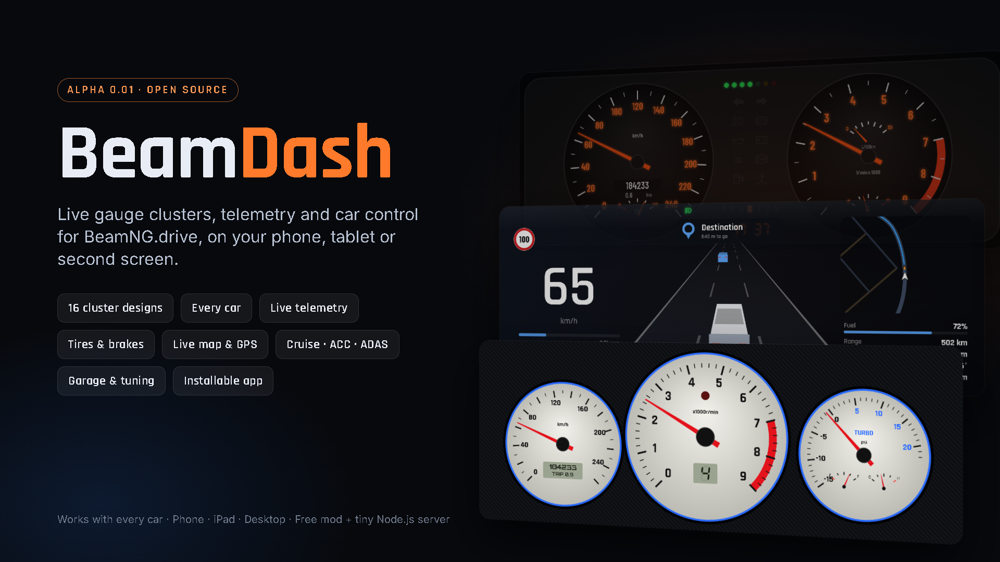
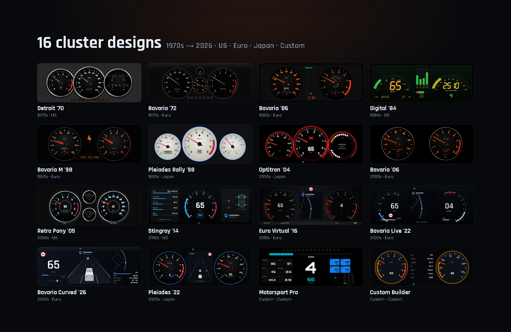
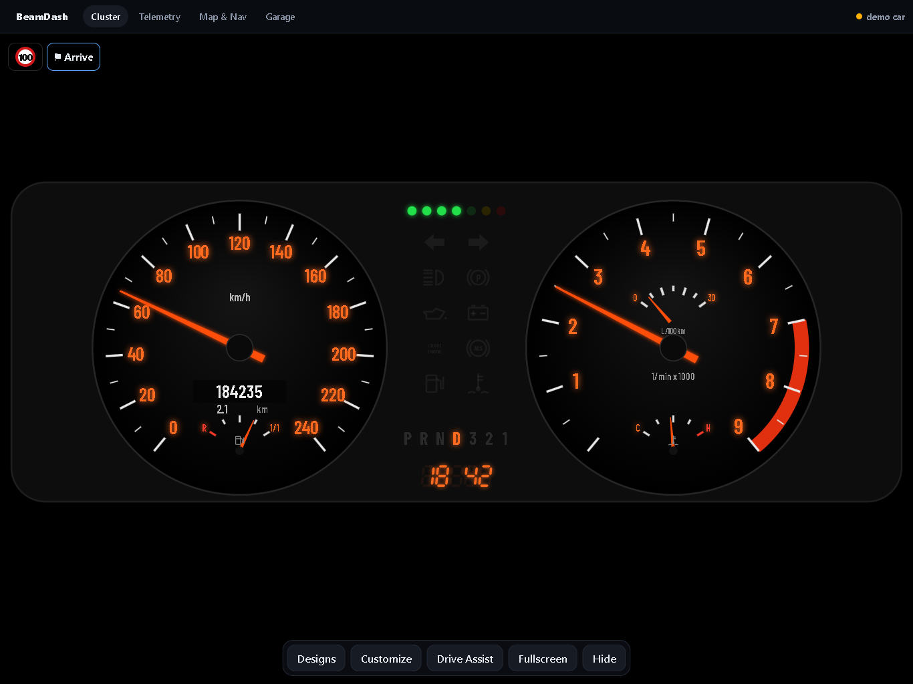
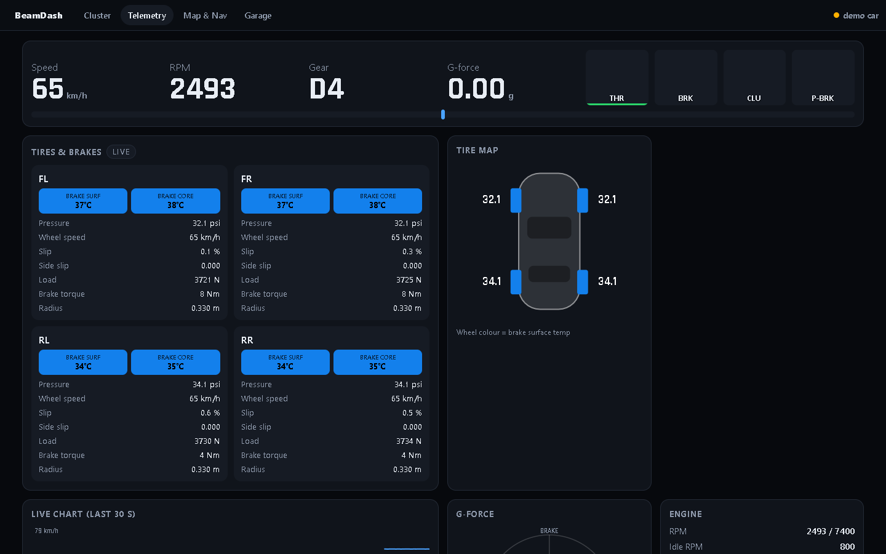
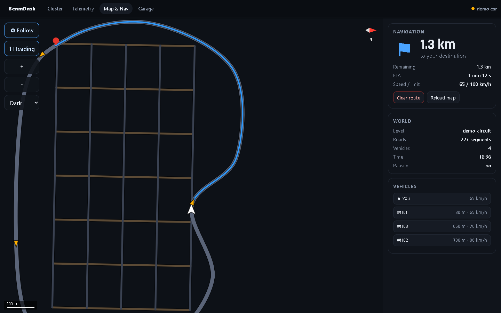
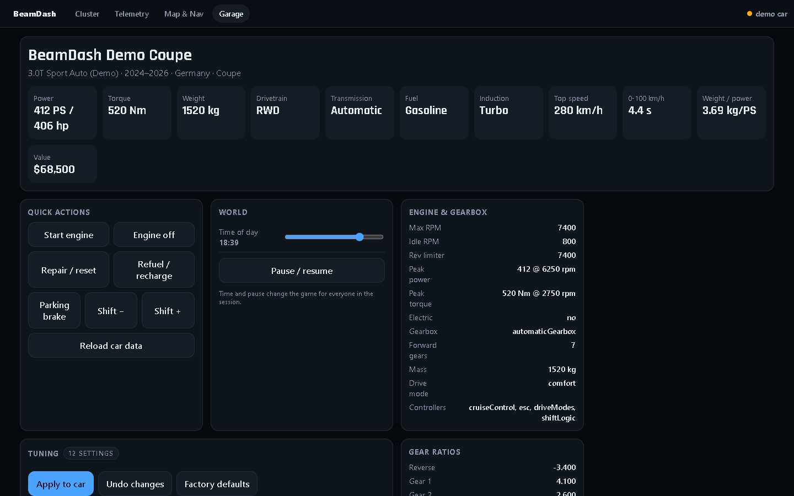

<p align="center"></p>

<p align="center"><b>Live gauge clusters, telemetry and car control for BeamNG.drive, on your phone, tablet or second screen.</b></p>

<p align="center">
  <a href="https://github.com/samsad001/BeamDash/releases"></a>
  
  
  
  <a href="LICENSE"></a>
</p>

<p align="center">
  <a href="#-quick-start">Quick start</a> ·
  <a href="#-features">Features</a> ·
  <a href="#-screenshots">Screenshots</a> ·
  <a href="#6-cluster-designs">Designs</a> ·
  <a href="docs/MOD_DOCUMENTATION.md">Documentation</a> ·
  <a href="docs/TECHNICAL.md">How it works</a> ·
  <a href="CHANGELOG.md">Changelog</a>
</p>

> [!WARNING]
> **Alpha 0.01.** Cruise control and adaptive cruise don't respond in-game in this release: the mod looks for a cruise *controller*, but BeamNG provides cruise as a vehicle *extension*. Everything else works. A fix is planned for the next release.

## ✨ Features

- 🎛️ **16 gauge-cluster designs** from the 1970s to 2026 (US, Euro, Japanese, a race display and a Custom Builder). Every one is customizable: colours, needles, units, redline, shift light, brightness.
- 🚗 **Works with every car**, stock or modded. Spawn a car and its details load automatically.
- 📊 **Live telemetry**: tire and brake temperatures, pressures, slip and load per wheel, engine and drivetrain, G-force, live charts, and every one of the ~200 values the game's UI apps can read.
- 🗺️ **Live map**: the level's real road network with every vehicle and your GPS route. Tap to navigate and the route appears in the game too.
- 🛡️ **Drive assist**: cruise control, adaptive cruise with 4 following distances, forward collision warning, emergency braking, blind-spot monitor, speed-limit signs, ESC and drive modes.
- 🔧 **Garage**: car specs, the car's tuning sliders, repair, refuel, engine start/stop, time of day, pause.
- 📱 **Phone, iPad or desktop**, installable as an app. A built-in **demo car** lets you try everything without the game.
- 🪶 **Tiny and self-contained**: a Node.js server with zero dependencies, no build step, OutGauge fallback without the mod.

<p align="center"></p>

## 📸 Screenshots

<table>
<tr><td width="50%"><br><sub><b>Cluster with controls (iPad)</b></sub></td><td width="50%"><br><sub><b>Telemetry</b></sub></td></tr>
<tr><td width="50%"><br><sub><b>Map & navigation</b></sub></td><td width="50%"><br><sub><b>Garage & tuning</b></sub></td></tr>
</table>

## 🚀 Quick start

1. **Download** `BeamDash-alpha-0.01.zip` from the [Releases page](https://github.com/samsad001/BeamDash/releases) and unzip it anywhere.
2. **Install the mod:** put `BeamDash-mod.zip` in your BeamNG `mods` folder, or run `bash install-mod.sh` (Linux) / `install-mod.ps1` (Windows). Don't put the whole download in `mods`.
3. **Start the server:** `bash start-server.sh` (Linux) or `start-server.bat` (Windows). You need [Node.js](https://nodejs.org) 18 or newer.
4. **Open the address it prints** (e.g. `http://192.168.1.20:8080`) on your phone, iPad or PC, and spawn a car in BeamNG.

No game running? The server shows a demo car so you can explore every screen first.

```
BeamNG.drive  --UDP-->  BeamDash server (Node)  --live stream-->  phone / iPad / PC browsers
   (mod)      <--UDP--                          <--commands----
```

---

## 1. Where things run

Only two pieces need installing:

- **The mod** goes on the machine that runs BeamNG.drive (Windows, native Linux, or Linux with Steam Proton).
- **The server** runs on any machine on your network: the game PC itself, another Linux / Windows PC, or a VM. It only needs Node.js 18+.

Phones, iPads and other PCs just open the website. Until a game is connected, the server runs a **demo car** so you can explore everything.

## 2. Server on Linux

```bash
sudo apt install nodejs          # Debian/Ubuntu; Fedora: sudo dnf install nodejs; Arch: sudo pacman -S nodejs
node -v                          # must be 18 or newer, otherwise install the LTS from https://nodejs.org
cp -r BeamDash /opt/BeamDash     # any folder works
cd /opt/BeamDash
bash start-server.sh             # add --game-host <game PC IP> if BeamNG runs on another machine
```

It prints the addresses to open on your phone, e.g. `http://my-pc:8080` or `http://192.168.x.x:8080`.

**Firewall** (only if one is active). With `ufw`:

```bash
sudo ufw allow 8080/tcp    # website
sudo ufw allow 4445/udp    # telemetry from the game (needed when the game is on another machine)
sudo ufw allow 4444/udp    # optional OutGauge fallback
```

With `firewalld`: `sudo firewall-cmd --permanent --add-port=8080/tcp --add-port=4445/udp && sudo firewall-cmd --reload`.

**Start at boot** (optional): edit `User=` and the paths in `beamdash.service`, then:

```bash
sudo cp beamdash.service /etc/systemd/system/
sudo systemctl daemon-reload && sudo systemctl enable --now beamdash
journalctl -u beamdash -f    # live log
```

## 3. Install the mod (on the machine that runs BeamNG)

- **Linux (native or Proton)**: `bash install-mod.sh`. It finds the BeamNG user folder (native, Steam Proton, or Flatpak Steam) and copies in `BeamDash-mod.zip`. If it can't find the folder, pass it yourself: `bash install-mod.sh "<user folder>/mods"`.
- **Windows**: right-click `install-mod.ps1` → *Run with PowerShell*.
- **Manual (any OS)**: copy `BeamDash-mod.zip` into BeamNG's user folder → `mods` (BeamNG → Options → Other → *Open user folder*).

Then start BeamNG.drive, make sure **BeamDash** is enabled in the Mod Manager, and spawn a car. The status dot in the top-right turns green: **BeamNG live**.

## 4. When the game and the server are on different machines

Start the server with the game machine's LAN IP:

```bash
bash start-server.sh --game-host 192.168.1.60        # Linux
start-server.bat --game-host 192.168.1.60            # Windows
```

The server keeps saying "hello" to the game on UDP port 4446. The mod then sends all telemetry back to whoever said hello, so nothing has to be configured inside BeamNG.

Firewall rules needed:
- **Server machine**: inbound TCP 8080 (web) and UDP 4445 (telemetry).
- **Game machine**: inbound UDP 4446 for BeamNG. On Windows, allow it when asked the first time. On Linux with ufw: `sudo ufw allow 4446/udp`.
- **VMs** need a **bridged** network adapter so your phone can reach them.

On Windows, if the firewall prompt for Node.js was missed, run this in an **admin** PowerShell:

```powershell
New-NetFirewallRule -DisplayName "BeamDash web" -Direction Inbound -Protocol TCP -LocalPort 8080 -Action Allow -Profile Private
```

Optional: the mod also reads `settings/beamDash.json` in the BeamNG user folder (`serverHost`, `serverPort`, `listenPort`) if you prefer to point it at the server yourself.

## 5. Install it as an app

- **iPhone / iPad**: open the site in Safari → Share → **Add to Home Screen**. It then opens full-screen like an app.
- **Android (Chrome)**: menu → **Install app** / **Add to Home screen**.
- **Desktop (Chrome / Edge)**: the install icon in the address bar.

Tips: use landscape on phones. Tap the cluster to hide or show the controls. On desktop, the ← → keys switch designs, `A` opens Drive Assist, and `H` hides the controls.

## 6. Cluster designs

| Era | Design | Inspired by |
|---|---|---|
| 1970s | Detroit '70 | American muscle (GM / Ford): chrome pods, rolling odometer, idiot lights |
| 1970s | Bavaria '72 | BMW 2002-era: twin dials, centre fuel/temp, analog clock (in-game time) |
| 1980s | **Bavaria '86** | BMW E30: orange glow, econometer, service-interval LEDs, P-R-N-D-3-2-1 |
| 1980s | Digital '84 | Corvette C4 LCD: segment bar graphs, 7-segment digits |
| 1990s | **Bavaria M '98** | BMW E36/E46 M3: warm-up redline LEDs, oil temp, check-control text |
| 1990s | Pleiades Rally '98 | Subaru WRX STI (GC8): white faces, centre tach, turbo gauge, shift light |
| 2000s | Optitron '04 | Electroluminescent (Lexus / 2004 STI): glowing rings, digital speed |
| 2000s | **Bavaria '06** | BMW E90: orange LCDs, cruise set-speed marker, econometer |
| 2000s | Retro Pony '05 | Ford Mustang S197: pick any backlight colour |
| 2010s | Stingray '14 | Corvette C7 TFT: Tour / Sport / Track modes, G-meter, tire temps |
| 2010s | Euro Virtual '16 | Audi Virtual Cockpit: live map, assist or car view in the middle |
| 2020s | **Bavaria Live '22** | BMW Live Cockpit (G20): follows drive mode colours, map or traffic view |
| 2020s | **Bavaria Curved '26** | Latest BMW curved display: 3-D surround traffic, ACC, nav, vitals |
| 2020s | Pleiades '22 | Subaru WRX (VB): EyeSight, boost, G or tire screens |
| Custom | Motorsport Pro | Race display: shift lights, tire/brake temps, alarms |
| Custom | Custom Builder | Choose layout, dial style, centre widget, fonts and every colour |

**Customize** (on the cluster): per-design colours and options, mph/km/h, °C/°F, psi/bar/kPa, redline and shift-light overrides, brightness, 30/60 fps, sounds.

## 7. How the data flows (and what "live" covers)

- Vehicle side (`beamDashVeh.lua`, inside every car): electrics at 30 Hz (speed, rpm, gear, pedals, temps, boost, lights, assists, cruise…), every electrics value at 4 Hz, wheels at 15 Hz (speed, slip, load, brake temps, pressure, deflated/broken), powertrain devices and fuel/battery tanks at 4 Hz, G-forces, position and heading.
- Game side (`beamDash.lua`): all vehicles, your GPS route, the road network for the map, car model/config info and tuning variables on spawn, and the ADAS logic.
- No mod? Turn on **OutGauge** in BeamNG (Options → Other → OutGauge, IP 127.0.0.1, port 4444). The cluster then works with basic data (no tires, map, ADAS or car control).

## 8. ADAS notes

The assists run in the mod, using the positions of all vehicles in the game:
- **ACC** holds your set speed, then slows down to keep the chosen time gap (4 settings) to the car ahead. It drives the car's own cruise control, so the car must have cruise control (most do).
- **FCW** warns from time-to-collision (Late / Normal / Early). **AEB** (off by default) applies full brakes below ~0.9 s.
- **Blind spot** lights up for cars in the next lane beside or just behind you.
- **Speed limit** comes from the level's road data, when the map has it.

## 9. Troubleshooting

- **Status stays "waiting for game" or "demo car"**: check that the mod is enabled. In BeamNG press `~` for the console and look for `BeamDash bridge loaded` or errors that mention `beamDash`.
- **Phone can't open the page**: same Wi-Fi? Try the IP address instead of the PC's name (on Linux the name often only works as `<name>.local`, through Avahi), and check the firewall rules above.
- **OutGauge with the server on another machine**: set the OutGauge IP in BeamNG to the server's IP instead of 127.0.0.1.
- **Map is empty**: Map & Nav → *Reload map* (large levels take a few seconds).
- **A button does nothing on a certain car**: that car lacks the controller (e.g. no drive modes). The page shows a short error message.

## Files

```
BeamDash/
  start-server.sh           start the server (Linux)
  start-server.bat          start the server (Windows)
  beamdash.service          systemd unit to run the server at boot (Linux)
  install-mod.sh            install the BeamNG mod (Linux: native or Proton)
  install-mod.ps1           build + install the BeamNG mod (Windows)
  BeamDash-mod.zip          the mod, ready to drop into BeamNG's mods folder
  server/server.js          web server, UDP bridge, OutGauge fallback (no npm install needed)
  server/demo.js            demo car used when the game isn't connected
  public/                   the web app (cluster, telemetry, map, garage)
    js/designs.js           all cluster designs; add your own with reg({...})
  beamng-mod/BeamDash/      mod source (Lua)
```

## 🧪 Status

This is an early alpha. It has been tested live on native Linux (BeamNG.drive with LuaSocket): car data, telemetry, the road map and car info all stream correctly. Tuning, navigation, lights and drive-mode commands, and Windows in-game, still need wider testing. Bug reports are very welcome: please [open an issue](https://github.com/samsad001/BeamDash/issues) with your BeamNG version, OS and any console (`~`) lines that mention `beamDash`.

## 📄 License

[MIT](LICENSE). Use it, change it, share it; keep the copyright notice.

Cluster designs are original artwork *inspired by* the look of real cars of each era. BeamDash is not affiliated with or endorsed by BeamNG GmbH or any car maker.
